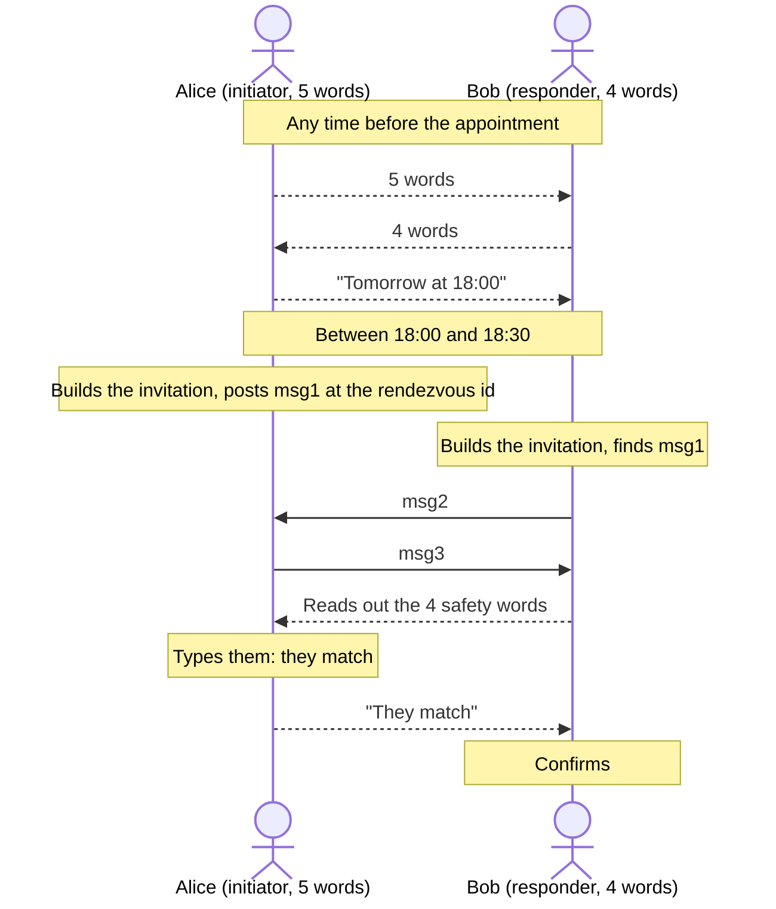

# Appointment mode

The two people each bring words and agree on a time. Each draws a group of words, they swap them
(even days ahead, and over different channels if they like) and set a start time. The invitation
works for 30 minutes from that time, and never again.

## At a glance

| | |
| --- | --- |
| People swap | A's 5 words, B's 4 words, and a start time `at` |
| Initiator | A, who drew the 5 words |
| Responder | B, who drew the 4 words |
| Usable | From `at` to `at + 30 minutes`, wall clock; the whole handshake must end by then |
| Wall clock | Read once, when each device builds the invitation |
| Guessing, per side | At most 2^-77; 2^-38 if A's words leak; 2^-33 if B's words leak |

## How it goes



1. Alice's device draws 5 words with `words(5)`, Bob's draws 4 with `words(4)`.
2. They swap their words and agree on a start time `at`, as Unix seconds. Applications should
   round it to the minute, since both sides must pass exactly the same value.
3. At the appointment, each device builds the invitation from both groups, `at` and the
   application's `context`. A device refuses to build it before `at` or after `at + 30 min`.
4. Alice's device posts msg1 at the rendezvous id; Bob's looks for it there and answers. The
   handshake runs as in [the handshake](handshake.md).
5. Bob's device shows 4 safety words. Bob reads them out, Alice types them, and both sides open
   the session, all before the window closes.

## Why two groups of words

In live mode, whoever intercepts the one message that carried the words holds the whole secret.
Here the secret is split between two people who each draw their part, so an attacker needs both.
The two groups can travel over different channels: Alice's words in a letter, Bob's in a text
message.

The time adds two things:

- **A short window.** Outside its 30 minutes, no device builds the invitation, so nobody can
  guess at it before or after.
- **No reuse.** `at` is part of the CPace channel identifier, so messages from one appointment
  never complete with an invitation for another time, even with the same words.

## Example

```rust
use nachalo::{Initiator, Invitation, Responder, words};

fn main() -> Result<(), nachalo::Error> {
    let context = b"my-app v1";
    let now = 0; // seconds, from each device's own monotonic clock

    // Days before: each draws a group, and they swap them and agree on a time.
    let alice_words = words(5);
    let bob_words = words(4);
    let at = 1_900_000_020; // the agreed start, as Unix seconds
    let at = at - at % 60; // rounded to the minute

    // At the appointment. now_unix is each device's wall clock, within [at, at + 1800].
    let now_unix = at + 120;

    // Both sides pass A's words first, then B's: the order is by role, not "mine, theirs".
    let alice_invitation = Invitation::appointment(&alice_words, &bob_words, at, context, now_unix)?;
    let (mut alice, msg1) = Initiator::start(&alice_invitation, b"Alice's payload", now)?;

    let bob_invitation = Invitation::appointment(&alice_words, &bob_words, at, context, now_unix)?;
    let (bob, msg2) = Responder::respond(&bob_invitation, &msg1, b"Bob's payload", now)?;

    let (alice, msg3) = alice.finish(&msg2, now)?;
    let bob = bob.finish(&msg3, now)?;

    let alice = alice.verify(&bob.safety_words(), now)?;
    let bob = bob.confirm(now)?;
    assert_eq!(alice.key(), bob.key());

    // Outside the window, the invitation cannot be built at all.
    let too_late = Invitation::appointment(&alice_words, &bob_words, at, context, at + 1801);
    assert_eq!(too_late.err(), Some(nachalo::Error::Expired));
    Ok(())
}
```

## How the invitation is derived

With `words_a` and `words_b` normalized, and `be64(x)` the 8-byte big-endian encoding of `x`:

```text
end        = at + 1800
PRS        = lv_cat(words_a, words_b)
CI         = lv_cat("Nachalo v0", context, "Nachalo v0 appointment", be64(at))
tag        = HKDF(salt = CI, ikm = words_a, info = "Nachalo v0 rendezvous tag", 2)
rendezvous = HKDF(salt = CI, ikm = tag, info = "Nachalo v0 rendezvous", 32)
ttl        = min(600, end - now_unix)
```

A device rejects the invitation unless `at <= now_unix <= end`. Because `ttl` stops at `end`, a
step started 5 minutes before the end only has 5 minutes left.

Only A's words go into the rendezvous id, through 16 bits. If the id came from all 9 words, it
would be an offline test for them: hard while both groups are secret, but once A's 5 words leak,
the remaining 44 bits could be tried within the window. Since every start time has its own ids,
16 bits are enough to keep unrelated appointments apart. See
[section 6.2 of the specification](../spec/nachalo.md#62-appointment).

## Security

| Attacker | Outcome |
| --- | --- |
| Watches the network | Learns nothing about the key, even with a future quantum computer. Learns at most 16 bits of A's words, nothing about B's. |
| Guesses the words online | 99 bits of secret, at most 64 guesses per side, only during the window: at most 2^-77. |
| Learned A's 5 words | Must still guess B's 44 bits online: at most 2^-38 per side. |
| Learned B's 4 words | Must still guess A's 55 bits, 16 of which leak through the id: at most 2^-33 per side. |
| Learned both groups and sits in the middle | Completes both handshakes and learns both payloads, but the safety words differ, except with probability at most 2^-38. |

## Pitfalls

- **Same order on both sides.** `Invitation::appointment(words_a, words_b, ...)` takes A's 5
  words first, B's 4 second, on both devices. Swapping them gives `BadWords` (the group sizes
  differ), and splitting the same 9 words differently is another invitation.
- **Same `at` on both sides,** to the second. Round it to the minute in the interface and pass the
  rounded value.
- **Build the invitation when you use it,** not ahead of time: its `ttl` comes from `now_unix` at
  build time.
- **Finish within the window.** The safety words count too. Starting at minute 29 leaves one
  minute for everything.
- **Answers reveal presence.** Each message shows its sender was online during the window. Apps
  that care can delay their answers by a random time within the remaining `ttl`.
- **After a missed appointment, draw new words.** The same words with a new `at` do make a new
  invitation, but they have been exposed for longer.

## When to use another mode

- Both people are available right now: [live](live.md) is simpler.
- They meet in person now, but do not know when they will connect: use a
  [physical token](physical-token.md).
