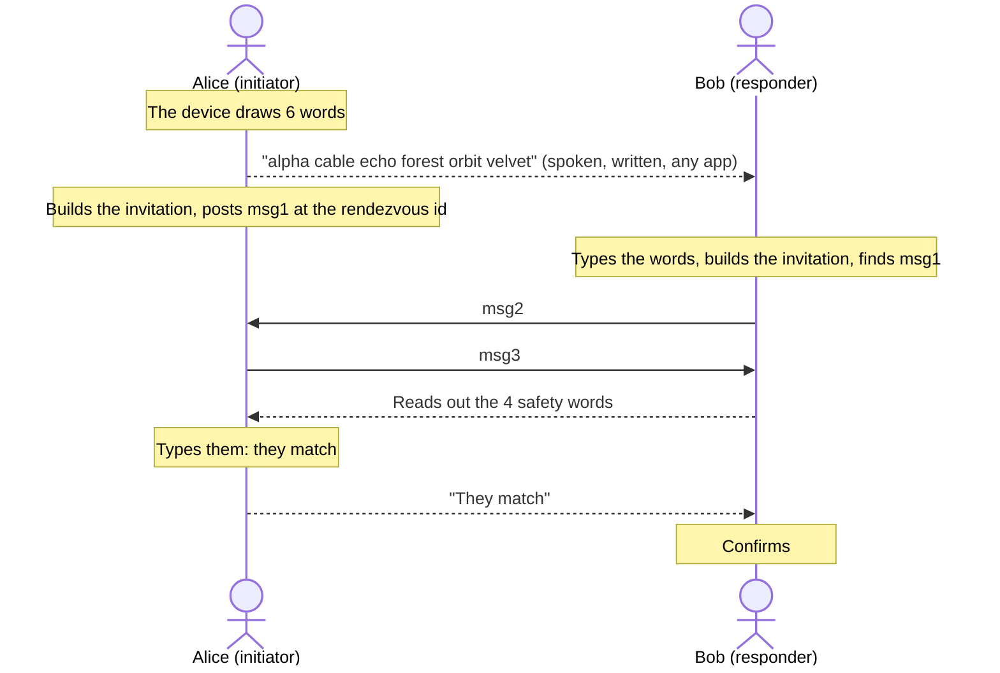

# Live mode

One person draws 6 words and gives them to the other; both devices run the handshake within
minutes. This is the simplest mode, for two people who are together or on a call right now.

## At a glance

| | |
| --- | --- |
| People swap | 6 random words, drawn by A's device |
| Initiator | A, who drew the words |
| Responder | B, who received them |
| Usable | Within `invite_ttl` of A starting: 10 minutes by default |
| Wall clock | Not checked |
| Guessing, per side | At most 2^-36 per invitation |

## How it goes



1. Alice's device draws 6 words from the BIP-39 list with `words(6)`. People must never pick the
   words themselves: chosen words are far easier to guess.
2. Alice gives them to Bob: out loud, on paper, or over another app.
3. Both devices build the same invitation from the words and the application's `context`.
4. Alice's device posts msg1 at the invitation's rendezvous id. Bob's device looks for it there
   and answers. The handshake runs as in [the handshake](handshake.md).
5. Bob's device shows 4 safety words. Bob reads them out, Alice types them, and both sides open
   the session.

The whole thing, safety words included, must finish within `invite_ttl` (10 minutes by default)
of each device's step. If
Bob has not answered in time, Alice draws new words and starts over.

## Example

```rust
use nachalo::{Clock, Config, Initiator, Invitation, Listener, words};

fn main() -> Result<(), nachalo::Error> {
    let context = b"my-app v1"; // equal on both sides, never sent
    let config = Config::default(); // each side's own limits
    // Each device's monotonic seconds and wall clock, read before every step.
    let clock = Clock { now: 0, now_unix: 1_900_000_000 };

    // Alice's device draws the words, and Alice gives them to Bob.
    let alice_words = words(6)?;
    let bob_typed = alice_words.to_uppercase(); // case and spacing do not matter

    // Alice starts and posts msg1 at the rendezvous id.
    let alice_invitation = Invitation::live(&alice_words, context, &config)?;
    let (mut alice, msg1) = Initiator::start(&alice_invitation, b"Alice's payload", clock)?;

    // Bob builds the same invitation, listens at the same id and answers msg1.
    let bob_invitation = Invitation::live(&bob_typed, context, &config)?;
    assert_eq!(bob_invitation.rendezvous(), alice_invitation.rendezvous());
    let mut bob_listener = Listener::new(&bob_invitation);
    let (bob, msg2) = bob_listener.respond(&msg1, b"Bob's payload", clock)?;

    let (alice, msg3) = alice.finish(&msg2, clock)?;
    let bob = bob.finish(&msg3, clock)?;

    // Bob reads out the safety words, Alice types them, then Bob confirms.
    let alice = alice.verify(&bob.safety_words(), clock)?;
    let bob = bob.confirm(clock)?;

    assert_eq!(alice.key(), bob.key());
    assert_eq!(alice.peer_payload(), b"Bob's payload");
    assert_eq!(bob.peer_payload(), b"Alice's payload");
    Ok(())
}
```

## How the invitation is derived

With `words` the 6 normalized words (lowercase, single spaces):

```text
PRS        = words                                          CPace password
CI         = lv_cat("Nachalo v0", context)                  CPace channel identifier
tag        = HKDF(salt = context, ikm = PRS, info = "Nachalo v0 rendezvous tag", 3)
rendezvous = HKDF(salt = context, ikm = tag, info = "Nachalo v0 rendezvous", 32)
ttl        = invite_ttl                                     600 seconds by default
```

The rendezvous id comes from only 3 bytes (24 bits) of a hash of the words, so many invitations
share each id. That is deliberate: whoever watches the id learns at most 24 of the 66 bits, and
cannot test guesses at the rest offline. See [section 6.1 of the specification](../spec/nachalo.md#61-live).

## Security

| Attacker | Outcome |
| --- | --- |
| Watches the network | Learns nothing about the key, even with a future quantum computer. Learns at most 24 bits of the words from the rendezvous id. |
| Guesses the words online | One guess per exchange with a victim, at most `max_answers` per side: success probability at most `max_answers / 2^42`, 2^-36 by default. |
| Read the words (for example, intercepted the message they were sent in) and sits in the middle | Completes both handshakes and learns both payloads, but the safety words differ, except with probability at most `max_answers / 2^44`, 2^-38 by default. |

The words are the only secret, so how they travel matters: saying them out loud or showing them
on a screen leaves less to intercept than sending them over another app.

## Pitfalls

- **Let the device draw the words.** A phrase someone made up has far less than 66 bits.
- **Compare safety words where you recognize each other.** In person or on a call, never over
  the channel the words went through.
- **One `Listener` per invitation on B.** B answers every msg1 at the rendezvous, and the
  listener stops after `max_answers` (64 by default).
- **Use a monotonic clock** for `Clock::now`, one that keeps counting while the device sleeps.
- **Discard everything** if the safety words really differ, and start over with new words.

## When to use another mode

- The two people cannot be online at the same moment right after swapping the words, or would
  rather not let one leaked message give away the whole invitation:
  use an [appointment](appointment.md).
- They meet in person now but want to connect later: use a [physical token](physical-token.md).
